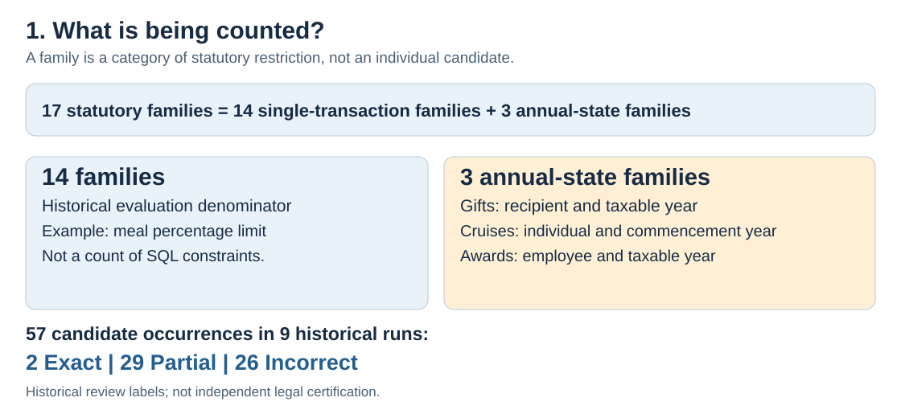
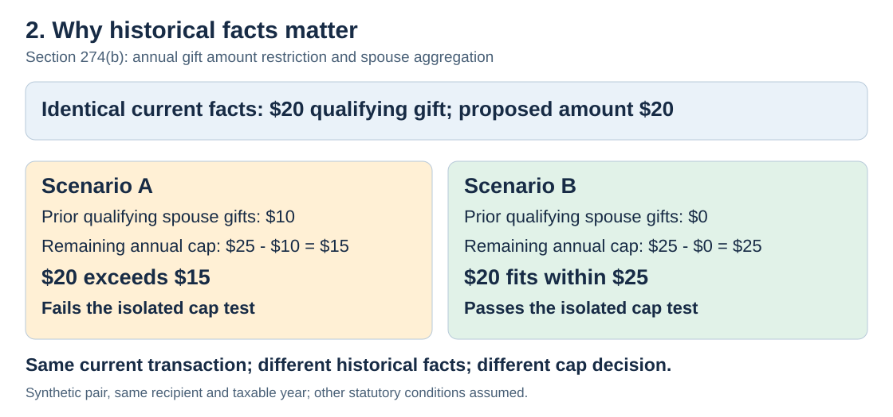
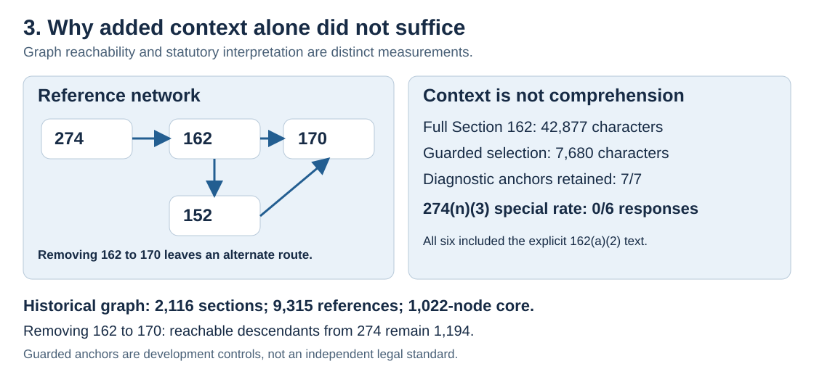
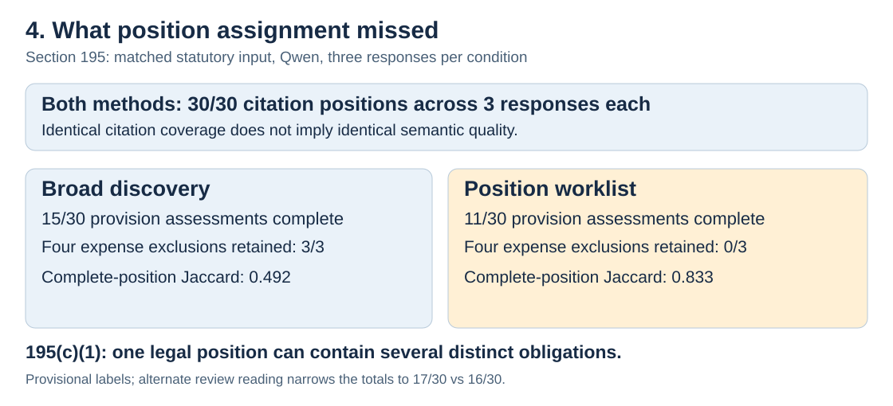

# DFC research review | November 24, 2026

## Research question

Can statutory context construction and semantic interpretation support reliable DFC policy construction under a clearly specified factual environment?

DFC restricts data movement according to a policy. In this research, a candidate policy describes whether a proposed deduction satisfies a specified statutory restriction. A restriction alone does not establish complete deduction entitlement.

## 1. What is a statutory family?

A family is a researcher-defined category of statutory restriction, not a distinct SQL constraint.

The historical inventory contains 17 families. Fourteen were eligible for the single-transaction evaluation. Three required annual aggregation: gifts, cruise conventions and employee achievement awards.

Nine historical trials contain 57 candidate occurrences and 29 distinct constraint strings. Their provisional assessment labels are 2 Exact, 29 Partial and 26 Incorrect.

The mean number of eligible families detected was 4.00/14 for target-only context, 3.33/14 for direct-reference context and 5.00/14 for bounded structural context.

Six families had no detection signal, including five of the fourteen eligible families.

[Family inventory](evidence/family_review.csv)

[Candidate-level defects and constraint text](evidence/candidate_review.csv)

## 2. Missing facts or incomplete interpretation?

Consider two synthetic cases with identical current facts. Each contains a qualifying $20 gift and a proposed deduction of $20.

In Scenario A, qualifying prior spouse gifts to the same recipient during the taxable year total $10. The remaining amount under the isolated annual cap is $15.

In Scenario B, the qualifying prior spouse amount is zero. The remaining cap is $25.

The proposed $20 fails the isolated cap test in Scenario A and passes it in Scenario B. Other statutory conditions are assumed.

The example illustrates why a current transaction alone may be insufficient for a policy decision.

All five archived factual-availability pairs passed the selected Passant checks.

The research distinguishes three possible deficiencies:

- Factual information is missing from the environment.
- Available statutory information is incompletely interpreted.
- A reviewed predicate behaves incorrectly during database enforcement.

These deficiencies require distinct evidence.

[Factual-availability pairs](evidence/factual_pairs.csv)

## 3. Reference selection and interpretation

The frozen section-level reference graph contains 2,116 nodes and 9,315 directed references.

A strongly connected component containing 1,022 nodes includes Sections 274, 162 and 170.

Removing the direct reference from Section 162 to Section 170 leaves alternative paths. The complete reachable set from Section 274 remains unchanged.

The 1,425 roots reaching this component also exceed the selected historical character-based capacity estimate. This is approximate prompt accounting, not an exact global token limit.

The local guarded selection condition retained all seven diagnostic anchors within 7,680 characters under an 8,000-character cap.

However, none of six downstream responses identified the special percentage under Section 274(n)(3), although every input contained its expressly referenced provision, Section 162(a)(2).

Four other explicit reference positions also had no citation signal.

Context availability and obligation discovery therefore require distinct evaluation.

The diagnostic anchors helped design the guarded condition and are not an independent legal standard.

[Context comparison](evidence/context_selection.csv)

[Downstream comparison](evidence/downstream_comparison.csv)

## 4. Repeated-run semantic completeness

The Section 195 development comparison contains three broad-discovery responses and three position-worklist responses.

All six identified all ten review positions.

The conservative provisional assessment found 15/30 complete cells for broad discovery and 11/30 for position assignment.

An alternate assessment reading narrows the difference to 17/30 versus 16/30.

Complete-position Jaccard measures the similarity of sets of provision positions judged complete in distinct runs. It does not independently measure legal correctness.

The clearest contrast concerns Section 195(c)(1). All three broad responses retained the four expense exclusions concerning Sections 163(a), 164, 174 and 174A in semantic fields. None of the position-worklist responses retained those exclusions.

This motivates exploring finer-grained obligation representation.

The single development case and non-independent assessment do not establish general superiority.

[Repeated-run comparison](evidence/section195_comparison.csv)

[Provisional semantic assessments](evidence/semantic_assessment.csv)

## Proposed research direction

Distinguish structural positions from atomic legal obligations.

A single statutory position may contain several qualifying conditions, definitions, exceptions and calculation requirements.

Preserve their logical dependencies and identify the necessary current and historical facts before constructing DFC predicates.

The next evaluation should distinguish:

1. Reference resolution.
2. Context selection.
3. Obligation discovery.
4. Semantic completeness.
5. Factual completeness.
6. Policy translation and database enforcement.
7. Repeated-run reliability.

I would appreciate feedback on the appropriate evaluation unit, independent assessment criteria, model comparison design and factual environment for TaxAgent.

## Scope and reproducibility

All examples concern frozen research material.

The selected Passant checks involve synthetic data and do not establish complete automatic policy construction or current tax compliance.

Candidate constraints and historical labels are retained as research evidence, not approved policies.

The review explanations contain minor wording adjustments for readability. Precise statutory categories and constraint text remain intact.

No new inference request or core implementation change is included.

[Evidence provenance](evidence/provenance.json)

Run `python verify_review.py` from this directory to verify the file digests and basic data consistency. The verifier does not replay inference or independently certify statutory interpretation.
